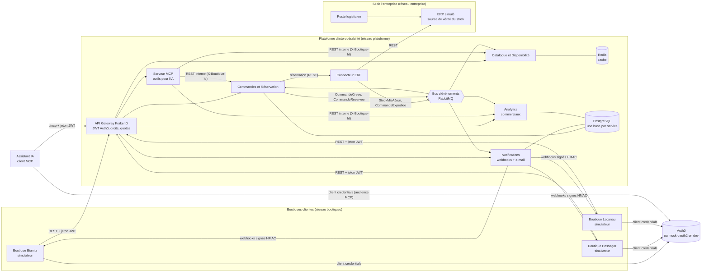
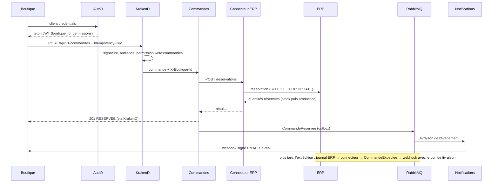

# Architecture du prototype

Ce document relie le prototype à l'étude technique (questions 5 et 6).

| Schéma | Contenu |
| --- | --- |
| [`schema-flux-to-be.excalidraw`](schema-flux-to-be.excalidraw) et [`.png`](schema-flux-to-be.png) | Solution **cible** de l'étude (y compris EDIFACT et CSV/SFTP, hors prototype) |
| [`architecture-actuelle.excalidraw`](architecture-actuelle.excalidraw) | Ce qui tourne réellement dans le prototype : réseaux, ports, flux REST, événements, webhooks, MCP |
| Vue d'ensemble ci-dessous (Mermaid) | Le même prototype, lisible directement sur GitHub |
| [`services/observatoire/schema/surfwear.architecture.json`](../services/observatoire/schema/surfwear.architecture.json) | Schéma archify de l'observatoire, animé en direct (http://localhost:8070) |

Les fichiers `.excalidraw` s'ouvrent sur excalidraw.com (*Open*) ou avec l'extension Excalidraw de VS Code.

## Périmètre du prototype

Le prototype implémente la solution TO BE avec **uniquement des échanges REST** et des événements :

- toutes les boutiques simulées sont de type A (logiciel capable d'appeler une API REST et de recevoir des webhooks) ;
- les adaptateurs EDIFACT et CSV/SFTP du schéma cible ne sont pas implémentés, par choix de périmètre. L'architecture permet de les ajouter comme de nouveaux adaptateurs, sans modifier les autres services ;
- l'identité est gérée par **Auth0** (OAuth2, jetons JWT) ;
- les assistants IA accèdent à la plateforme par un serveur MCP (Model Context Protocol), placé derrière la passerelle (voir [mcp.md](mcp.md)).

## Vue d'ensemble

## Trajet d'une commande

## Services

| Service | Rôle | Stockage | Publie | Consomme |
| --- | --- | --- | --- | --- |
| `gateway` | **KrakenD CE** : point d'entrée unique, vérification des jetons (JWKS), contrôle des permissions par route, injection de l'identité de la boutique (`propagate_claims`), limitation de débit. Routes déclarées dans `infra/krakend/settings/routes.json` | aucun | | |
| `catalogue` | Catalogue, stock réel et potentiel, calcul de délai pour une quantité | Redis | | StockMisAJour |
| `commandes` | Création des commandes, réservation immédiate dans l'ERP, suivi, reprise si l'ERP est indisponible | PostgreSQL | CommandeCreee, CommandeReservee | CommandeExpediee |
| `notifications` | Abonnements des boutiques, webhooks signés avec nouvelles tentatives, e-mails | PostgreSQL | | CommandeReservee, CommandeExpediee |
| `analytics` | Statistiques pour les commerciaux (activité, références en tension) | PostgreSQL | | CommandeReservee, CommandeExpediee |
| `mcp` | Serveur MCP derrière KrakenD : outils pour les assistants IA (catalogue, disponibilité, préparation et passage de commande, suivi, références en tension), permission vérifiée par outil | aucun | | |
| `erp-connector` | Adaptateur : façade REST vers l'ERP et traduction de son journal de changements en événements | Redis (position de lecture) | StockMisAJour, CommandeExpediee | |
| `erp-mock` | ERP simulé, avec l'écran du logisticien | PostgreSQL | | |
| `boutique-simulator` | Logiciel de gestion d'une boutique : commande par API, réception des webhooks, stock local | mémoire | | |
| `mock-oauth2` | Faux fournisseur OAuth2 du mode `dev` et de la CI : vrais jetons signés, mêmes permissions et claim `boutique_id` qu'Auth0 (`infra/mock-oauth2/config.json`) | aucun | | |
| `swagger-ui` | Documentation interactive tirée de `docs/openapi.yaml`, qui appelle la passerelle | aucun | | |
| `observatoire` | Démo animée des flux (profil `demo`) : reçoit les traces de tous les services et pilote la visite guidée | aucun | | traces (`surfwear.traces`) |

## Choix techniques et problèmes résolus

| Problème (question 5) | Solution dans le prototype |
| --- | --- |
| **P1.** ERP fermé | L'ERP reste sur un réseau isolé (`entreprise`). Seul le connecteur ERP y accède. Les boutiques ne le voient jamais. |
| **P2.** Stock mis à jour en différé, doubles réservations | Réservation dans l'ERP au moment de la commande, dans une transaction qui verrouille les lignes de stock (`SELECT ... FOR UPDATE`, ordre de verrouillage fixe pour éviter les interblocages). Le surplus est réservé sur la production en cours, avec sa date. |
| **P3.** Disponibilité | Le catalogue est servi depuis un cache Redis tenu à jour par les événements : il répond même si l'ERP est arrêté. Une commande reçue pendant une panne est acceptée (HTTP 202) puis réservée automatiquement au retour de l'ERP. Chaque service redémarre automatiquement. |
| **P4.** Coût des licences | Les boutiques n'ont pas de compte ERP : elles passent par l'API. |
| **P5.** Échanges non structurés | Confirmations et bons de livraison envoyés en JSON (CloudEvents), signés en HMAC SHA-256, avec nouvelles tentatives et journal de livraison. |
| **P6.** Logiciels hétérogènes | Un contrat d'API unique et documenté (OpenAPI 3, AsyncAPI 3) au lieu de liaisons point à point. |
| **P7.** Pas de référentiel commun | Tous les articles sont identifiés par leur code GTIN (EAN-13, standard GS1). |
| **P8.** Scalabilité humaine | Commandes en libre-service. Le service Analytics donne aux commerciaux les références en tension. |
| **P9.** Maintenabilité | Monorepo, services indépendants et conteneurisés, journaux JSON structurés, métriques Prometheus, santé (`/health`), tests de bout en bout dans la CI. |

## Deux modes d'authentification

| `AUTH_MODE` | Qui délivre les jetons | Usage |
| --- | --- | --- |
| `dev` (par défaut) | `mock-oauth2`, audiences `https://api.surfwear.example` et `https://mcp.surfwear.example` | développement, démonstration, CI |
| `auth0` | le tenant Auth0, configuré par Terraform (`infra/terraform/auth0`) | production et tests réalistes |

La passerelle KrakenD vérifie les jetons de la même manière dans les deux modes (`auth/validator` : JWKS, émetteur, audience, permissions). Les audiences réelles d'un tenant sont celles de son `terraform.tfvars` (`audience`, `mcp_audience`) ; le tenant de production utilise `https://api.surfwear.isi` et `https://mcp.surfwear.isi` (valeurs par défaut de Terraform et du déploiement).

## Fiabilité des échanges

- **Idempotence** : chaque commande porte un en-tête `Idempotency-Key`. Une boutique qui réessaie après une coupure réseau ne crée jamais de doublon. L'ERP est lui aussi idempotent sur l'identifiant de commande.
- **Outbox transactionnelle** : le service Commandes écrit ses événements dans sa base, dans la même transaction que la commande. Une tâche de fond les publie ensuite. Aucun événement n'est perdu si le bus est momentanément indisponible.
- **Au moins une fois** : les messages sont persistants et confirmés. En cas d'échec de traitement, ils passent par des files d'attente `*.retry.1`, `*.retry.2` et `*.retry.3` (2, 4 puis 8 secondes) avant d'être rejoués. La copie est confirmée par RabbitMQ avant que l'original soit acquitté : un redémarrage pendant l'attente ne perd rien. Après 3 échecs, le message est placé dans la file d'erreurs du service (`*.dlq`), consultable dans la console RabbitMQ.
- **Journal de changements de l'ERP sans trou** : le connecteur relit le journal à partir du dernier numéro lu. Les écritures dans le journal sont sérialisées par un verrou PostgreSQL gardé jusqu'à la validation, pour que les numéros suivent l'ordre des validations et qu'aucun changement ne soit sauté.
- **Dédoublonnage** : chaque événement a un identifiant unique, utilisé par les consommateurs (Analytics, simulateurs de boutique).

## Observabilité des échanges (démo)

Chaque service publie une trace par échange (requête, réponse, événement, webhook, e-mail, nouvel essai, file d'erreurs) sur l'échange RabbitMQ `surfwear.traces`, de type *fanout* et non durable : sans observateur branché, les traces sont jetées. Le service `observatoire` (profil `demo`) les remet dans l'ordre chronologique et les diffuse au navigateur, qui anime les flux sur le schéma d'architecture. L'ERP, isolé, ne publie rien : ses échanges sont tracés par le connecteur.

## Sécurité

- Jetons JWT Auth0 vérifiés par la passerelle KrakenD : signature RS256 (clés publiques JWKS, mises en cache), émetteur, audience et expiration.
- Configuration Auth0 décrite en code (Terraform, `infra/terraform/auth0`) : API, permissions, applications, autorisations et Action, reproductibles et revues comme du code.
- Contrôle par permission : une boutique peut commander, un commercial peut consulter les statistiques, et pas l'inverse.
- Cloisonnement : l'identifiant de boutique est imposé par la passerelle à partir du claim `boutique_id` du jeton ; un en-tête `X-Boutique-Id` forgé par le client est écrasé par la valeur du jeton (testé dans `scripts/smoke-test.sh`). Les profils sans boutique, comme le commercial, n'ont la permission d'aucune route qui s'appuie sur la boutique. Une boutique ne peut pas lire les commandes d'une autre (réponse 404).
- Webhooks signés avec un secret propre à chaque abonnement.
- Trois réseaux Docker séparés (`boutiques`, `plateforme`, `entreprise`).
- Limitation de débit sur l'API (300 requêtes par minute et par adresse IP, `qos/ratelimit/router`).
- Serveur MCP : audience dédiée (un jeton REST est refusé sur `/mcp`, et inversement), outils filtrés par permission, et jamais de réutilisation du jeton reçu (*token passthrough* interdit par la spécification MCP).

## Passage à la production (hors prototype)

- **Orchestration Kubernetes** : chaque service en plusieurs réplicas, mise à l'échelle automatique, déploiement sans interruption.
- **Briques managées** : RabbitMQ ou Kafka en cluster, PostgreSQL et Redis répliqués.
- **Adaptateurs EDIFACT (AS2) et CSV (SFTP)** pour les boutiques de type B et C.
- **Portail web** pour les responsables de boutique (Auth0 Authorization Code + PKCE).
- **Serveur MCP, phase 2** : connexion des responsables de boutique depuis Claude.ai ou Claude Desktop (OAuth Authorization Code + PKCE avec Auth0).
