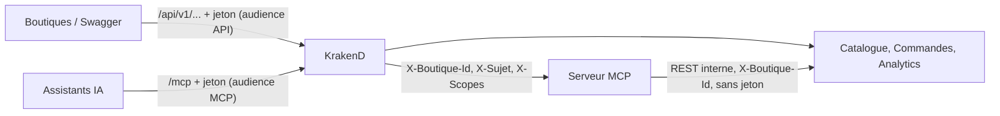
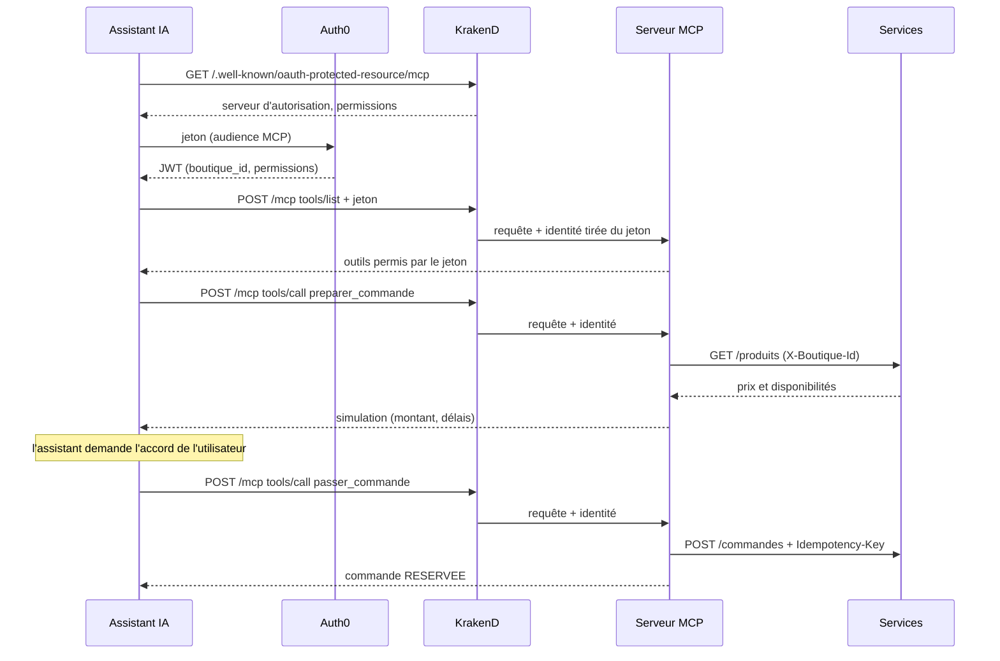

# Serveur MCP : les assistants IA sur la plateforme

Le serveur MCP (*Model Context Protocol*) permet à un assistant IA (Claude, ChatGPT, Copilot…) d'utiliser la plateforme : consulter le catalogue et la disponibilité, préparer une commande, la passer après accord, la suivre. Il implémente la spécification MCP **2026-07-28** (et reste compatible avec les clients 2025).

Exemples : « Ai-je de quoi tenir le week-end en boardshorts taille 34 ? Sinon, commande-m'en 10. », ou, pour un commercial, « Quelles références sont en tension ? ».

## Architecture





- Le serveur MCP (`services/mcp`) est **derrière la passerelle KrakenD**, comme les autres services : une seule porte d'entrée pour la sécurité, les quotas et les journaux.
- KrakenD vérifie le jeton (signature, expiration, **audience du serveur MCP**), puis transmet l'identité tirée du jeton : `X-Boutique-Id` (claim `boutique_id`), `X-Sujet`, `X-Scopes` (permissions).
- Le serveur MCP ne voit jamais le jeton et appelle les services internes avec `X-Boutique-Id`, sans jeton : la spécification MCP interdit de réutiliser le jeton reçu pour une autre API (*token passthrough*).
- Sans état : chaque requête est servie par une instance neuve, réponses JSON. Rien à configurer sur le VPS : nginx envoie déjà tout vers KrakenD.

## Outils, ressource et prompt

| Outil | Permission | Rôle |
| --- | --- | --- |
| `rechercher_produits` | `read:catalogue` | articles, prix, stock réel et production à venir ; filtre par catégorie ou texte |
| `verifier_disponibilite` | `read:catalogue` | pour une quantité : tout de suite, plus tard (avec date), ou non disponible |
| `preparer_commande` | `read:catalogue` | simulation sans réservation, montant estimé |
| `passer_commande` | `write:commandes` | commande ferme (stock réservé dans l'ERP), clé d'idempotence ; l'assistant doit demander confirmation |
| `lister_commandes`, `suivre_commande` | `read:commandes` | commandes de la boutique du jeton |
| `references_en_tension` | `read:stats` | commerciaux : demande supérieure au stock |

- **Ressource** `surfwear://catalogue` : le catalogue complet, lisible par l'assistant.
- **Prompt** `reassort_hebdomadaire` : guide l'assistant pour proposer un réassort, le simuler, puis le commander après accord.

Un assistant ne voit que les outils permis par son jeton : une boutique a `passer_commande`, un commercial a `references_en_tension`. Chaque outil vérifie aussi sa permission (`requireScopes` du SDK), en défense en profondeur.

## Authentification

- Audience dédiée (variable `MCP_AUDIENCE`) : `https://mcp.surfwear.example` en mode dev et sur le tenant de développement, `https://mcp.surfwear.isi` en production (valeur par défaut de `mcp_audience` dans Terraform et du déploiement). Un jeton de l'API REST ne fonctionne pas sur `/mcp`, et inversement.
- Découverte OAuth (RFC 9728), publique : `GET /.well-known/oauth-protected-resource/mcp` indique le serveur d'autorisation (Auth0, ou le faux fournisseur en mode dev).
- Auth0 : l'API « MCP Surfwear B2B » et les autorisations des boutiques et du commercial sont dans `infra/terraform/auth0/mcp.tf` (`terraform apply`).

## Tester

**Jeton** (valable 24 h) :

```bash
bash scripts/jeton.sh B001 --mcp           # copié dans le presse-papiers
```

**Test automatique** (client MCP officiel, protocoles 2025 et 2026, aussi lancé par la CI) :

```bash
node scripts/mcp-test.mjs
```

**MCP Inspector** (interface graphique) :

```bash
npx @modelcontextprotocol/inspector
```

Transport **Streamable HTTP**, URL `http://localhost:8080/mcp`, en-tête `Authorization: Bearer <jeton>`, puis **Connect** et l'onglet **Tools**.

**Claude Code** :

```bash
claude mcp add --transport http surfwear http://localhost:8080/mcp --header "Authorization: Bearer $(bash scripts/jeton.sh B001 --imprimer --mcp)"
```

**Observatoire** (`docker compose --profile demo up -d`, http://localhost:8070, mode dev) : l'étape « Un assistant IA commande (MCP) » montre le trajet assistant → KrakenD → serveur MCP → services en direct.

**Production** : https://mcp.hamidnd.me/mcp (seules `/mcp` et la découverte OAuth sont publiées sur ce domaine).

## Ajouter un outil

1. Une fonction `serveur.registerTool(...)` dans `services/mcp/src/outils.js`, avec son schéma d'entrée (zod), ses annotations (`readOnlyHint`…) et `scopeChallenge: requireScopes('<permission>')`.
2. Elle appelle un service interne avec `appel(url)` : l'en-tête `X-Boutique-Id` est ajouté automatiquement.
3. Un cas dans `scripts/mcp-test.mjs`.

Aucun changement dans KrakenD : la route `/mcp` couvre tous les outils.

## Étape suivante (phase 2)

Connexion des vrais utilisateurs (responsables de boutique) depuis Claude.ai ou Claude Desktop : flux OAuth *Authorization Code* + PKCE avec Auth0, application de l'assistant enregistrée à l'avance, Action *post-login* qui ajoute `boutique_id`, le tout en Terraform. Le serveur MCP et KrakenD ne changent pas.
